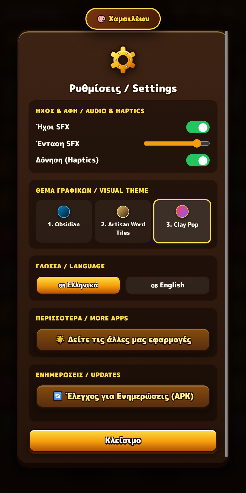
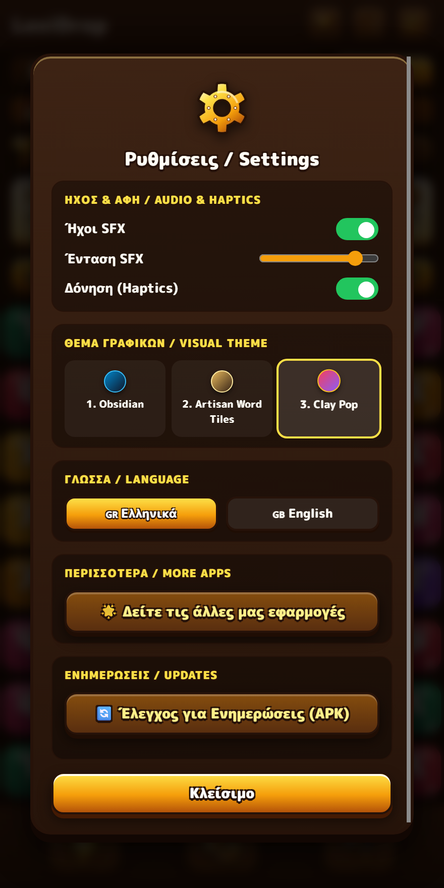
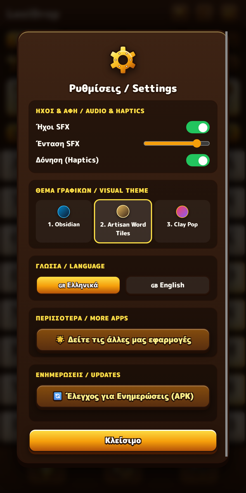

# 📜 LexiDrop - Official Releases

<h3>Artisan Word Tiles Collapse &amp; Brain Trivia Puzzle</h3>

<em>Συνδέστε γειτονικά γράμματα, προκαλέστε καταρρεύσεις βαρύτητας και λύστε κουίζ γνώσεων!</em>

 

<!-- ==================== MEGA CENTERED DOWNLOAD BUTTON ==================== -->

  

## 👉 [📲 Download lexidrop.apk (Direct Download)](https://github.com/jemangr/lexidrop-releases/releases/latest/download/lexidrop.apk) 👈

<em>(Πάντα η τελευταία επίσημη έκδοση APK • Αυτόματη άμεση λήψη • Android 8.0+)</em>

 

  
  
  
  

---

## 📥 Άμεση Λήψη Εφαρμογής (APK)

Πατήστε το κουμπί για να κατεβάσετε άμεσα το επίσημο APK στο κινητό σας:

 

  

### 📱 **[👉 Download lexidrop.apk (Direct Download) 👈](https://github.com/jemangr/lexidrop-releases/releases/latest/download/lexidrop.apk)**

<small><em>(Απευθείας λήψη του τελευταίου release χωρίς ενδιάμεσες σελίδες)</em></small>

  

*(Μπορείτε να δείτε όλα τα προηγούμενα builds και changelogs στη [Σελίδα GitHub Releases](https://github.com/jemangr/lexidrop-releases/releases).)*

---

## ✨ Χαρακτηριστικά & Δυνατότητες (v1.2.0)

- 🔠 **Artisan Word Tiles Mechanics:** Σύρετε το δάχτυλό σας προς οποιαδήποτε κατεύθυνση (οριζόντια, κάθετα, διαγώνια) για να σχηματίσετε έγκυρες λέξεις στο ταμπλό 7×8.
- 🌠 **Κατακρήμνιση Βαρύτητας (Gravity Collapse):** Οι λέξεις εξαφανίζονται με ρεαλιστικά σωματίδια ξύλου και νέα γράμματα πέφτουν από ψηλά σε πραγματικό χρόνο!
- 📜 **Brain Quiz Trivia Targets:** 400 ερωτήσεις γνώσεων ανά γλώσσα (800 συνολικά) σε Γεωγραφία, Ιστορία, Μυθολογία, Επιστήμη, Τέχνες και Φύση, συν 200 επιπλέον λέξεις καθημερινού λεξιλογίου! Εντοπίστε τη λέξη-στόχο για τεράστιο bonus score και χρυσό fanfare!
- ⚡ **4 Ειδικά Πλακίδια Δύναμης:**
  - ⚡ **Κεραυνός (Lightning Tile):** Καθαρίζει ολόκληρη τη γραμμή και τη στήλη σε ένα φωτεινό shockwave!
  - ★ **Prism Wild (Μπαλαντέρ):** Λαμπερό μπαλαντέρ που ταιριάζει με οποιοδήποτε γράμμα.
  - 💣 **Βόμβα (Bomb):** Εκρήγνυται σε ακτίνα 3×3.
  - **×2 Multiplier:** Διπλασιάζει όλους τους πόντους της λέξης.
- 📅 **Daily Challenge Mode (Καθημερινή Πρόκληση):** Κοινή παγκόσμια πρόκληση της ημέρας με κοινό seed. Λύστε 3 διαδοχικές ερωτήσεις και κερδίστε το τρόπαιο Daily Champion!
- 🏆 **Αίθουσα 10 Επιτευγμάτων & Τροπαίων:** Ξεκλειδώστε μοναδικά παράσημα (Πρωτομάστορας, Σοφός του Ολύμπου, Αστραπιαίος, Μεγαλολεξικό, Καταστροφέας κ.ά.).
- 📢 **Κοινοποίηση Σκορ:** Με ένα κλικ μοιραστείτε τα ρεκόρ και τις καθημερινές σας νίκες μέσω Web Share API ή Clipboard.
- 🎨 **3 Μοναδικά Θέματα Γραφικών:**
  1. **Obsidian Glass:** Μοντέρνο Dark Mode με frosted glass και neon cyan λάμψη.
  2. **Artisan Word Tiles (Default):** Vintage γραφείο καρυδιάς, παλαιωμένη περγαμηνή και σκαλιστά πλακίδια από ελεφαντόδοντο.
  3. **Candy Clay:** Παιχνιδιάρικο 3D pop με λαχταριστά ζελεδάκια καραμέλας.
- 🕹️ **4 Game Modes:** Classic, 60s Blitz (Word Rush), Zen, και Daily Challenge.
- 🇬🇷 / 🇬🇧 **Δίγλωσσο Λεξικό:** Άμεση αλλαγή μεταξύ Ελληνικών και Αγγλικών λεξικών και ερωτήσεων trivia.
- 🎵 **Procedural ASMR Ήχος & Haptics:** Αυθεντικοί ήχοι marimba που ανεβαίνουν κλίμακα καθώς μεγαλώνει η λέξη, ηλεκτρικοί κεραυνοί και απτική δόνηση.
- 🔄 **Αυτόματος Έλεγχος Ενημερώσεων:** Ενσωματωμένος έλεγχος στο παρασκήνιο ανά 6 ώρες για νέες εκδόσεις APK με ένα κλικ.
- 📱 **Οι Άλλες μας Εφαρμογές:** Άμεση καρτέλα προς τις υπόλοιπες εφαρμογές του δημιουργού στο [jemangr.app](https://jemangr.app).

---

## 📸 Screenshots Gallery

| 1. Obsidian Glass | 2. Artisan Word Tiles (Default) | 3. Candy Clay |
| :---: | :---: | :---: |
|  |  |  |

| 4. Achievements Hall | 5. Daily Challenge Mode | 6. Settings & Audio |
| :---: | :---: | :---: |
|  |  |  |

| 7. Our Other Apps (jemangr.app) | 8. English Blitz Mode |
| :---: | :---: |
|  |  |

---

## 🛠️ Οδηγίες Εγκατάστασης στο Κινητό (Android)

1. Πατήστε το κουμπί **[Download lexidrop.apk](https://github.com/jemangr/lexidrop-releases/releases/latest/download/lexidrop.apk)** από το κινητό σας.
2. Ανοίξτε το αρχείο που κατεβάσατε από τις Λήψεις.
3. Αν σας ζητηθεί, επιτρέψτε την "Εγκατάσταση από άγνωστες πηγές".
4. Ανοίξτε το **LexiDrop** και ξεκινήστε το παιχνίδι!

---

## 📄 License & Ownership

**Copyright (c) 2026 Giannis. All rights reserved.**  
All Rights Reserved.  
Original game concept, programming, visual theme design, and procedural audio engine developed by **Giannis**.  
Explore more creations at [jemangr.app](https://jemangr.app).
