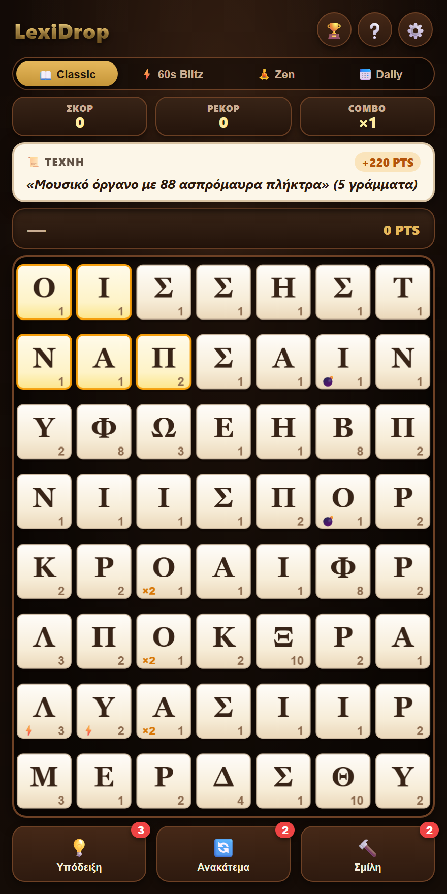
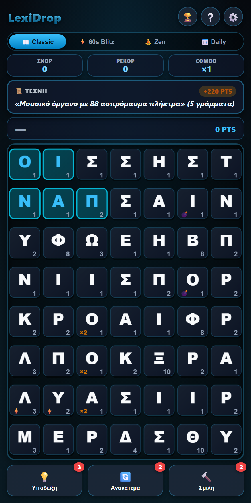
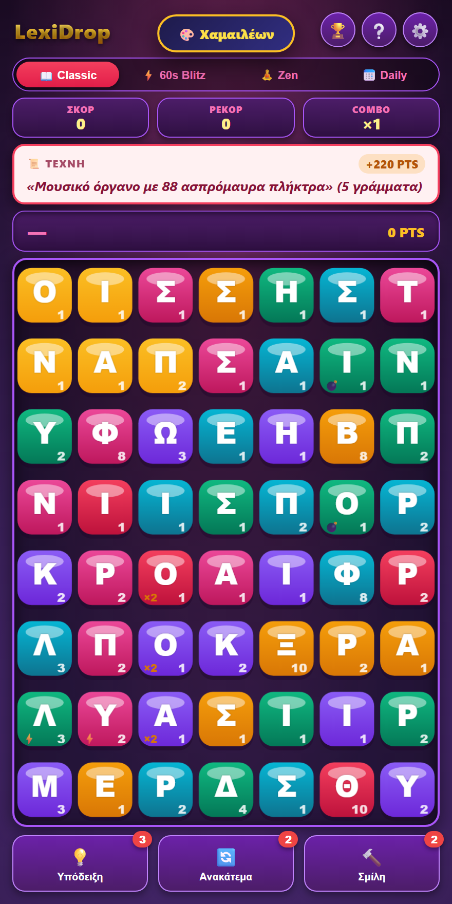
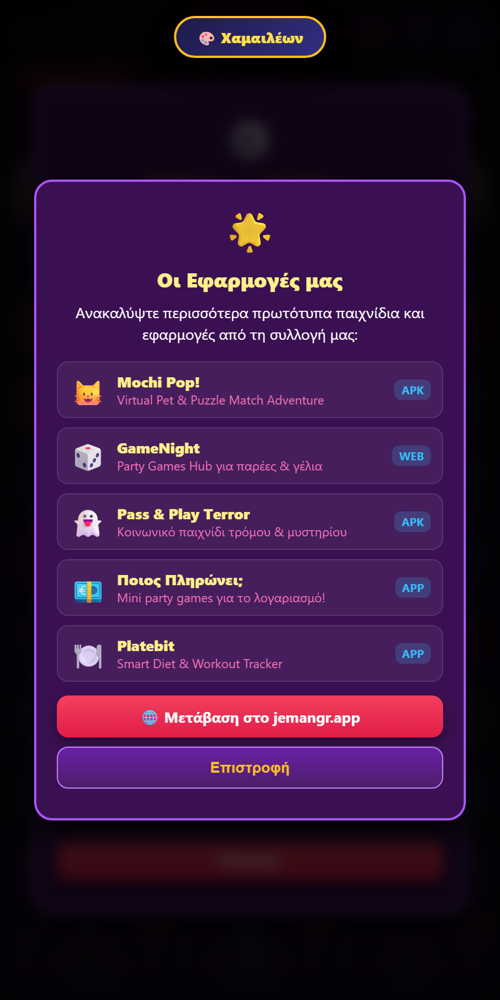
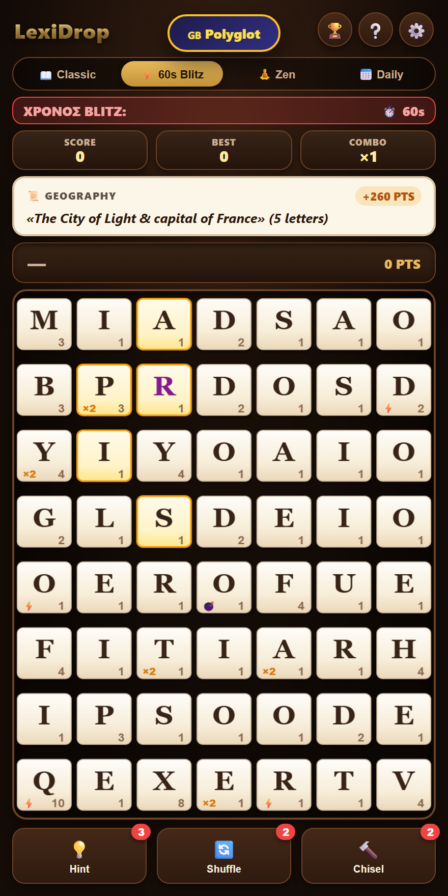

# 📜 LexiDrop - Official Releases

  

  <strong>Artisan Scrabble Word Collapse & Brain Trivia Puzzle</strong> 
  <em>Connect adjacent letters, trigger gravity collapses, and solve trivia bounties!</em>

  
  

  
  
  
  

---

## 📥 Direct APK Download

Download the latest certified release APK directly using the permanent link:

👉 **[Download lexidrop.apk (Direct Download)](https://github.com/jemangr/lexidrop-releases/releases/latest/download/lexidrop.apk)** 👈

*(Browse all previous builds and changelogs on the [GitHub Releases Page](https://github.com/jemangr/lexidrop-releases/releases).)*

---

## ✨ Features & Highlights (v1.1.0)

- 🔠 **Artisan Scrabble Mechanics:** Touch and drag across adjacent letter tiles in any direction (horizontal, vertical, diagonal) to form words.
- 🌠 **Gravity Collapse:** Valid words pop with tactile satisfaction, dropping new letter tiles from the ceiling in real time.
- 📜 **Brain Quiz Trivia Targets:** 50+ curated questions per language across Geography, History, Mythology, Science, and Arts!
- ⚡ **4 Special Tile Types:**
  - ⚡ **Lightning Tile:** Clears the entire row and column in a spectacular shockwave!
  - ★ **Prism Wild:** Shimmering wildcard tile substituting for *any* letter.
  - 💣 **Bomb:** Destroys surrounding 3×3 tiles.
  - **×2 Multiplier:** Doubles your entire word score.
- 📅 **Daily Challenge Mode (Seeded):** A shared global challenge seeded by calendar date. Solve 3 progressive daily trivia quests and earn the Daily Champion badge!
- 🏆 **10 Achievements & Trophies Hall:** Unlock rewarding badges (Word Apprentice, Trivia Sage, Blitz Striker, Lexicon Titan, Board Buster, Daily Champion, etc.).
- 📢 **Result Card Sharing:** One-tap sharing of your scores and daily triumphs via native Web Share API or clipboard.
- 🎨 **3 Gorgeous Visual Themes:**
  1. **Obsidian Glass:** Modern frosted glass with neon cyan glow.
  2. **Artisan Scrabble (Default):** Vintage walnut desk, aged parchment, and ivory tiles.
  3. **Candy Clay:** Cheerful 3D pop aesthetic with juicy candy gummy tiles.
- 🕹️ **4 Game Modes:** Classic, 60s Blitz (Word Rush), Zen, and Daily Challenge.
- 🇬🇷 / 🇬🇧 **Bilingual Dictionaries:** Instant one-tap switching between comprehensive Greek and English word banks and trivia clues.
- 🎵 **Procedural Audio & Haptics Engine:** Organic marimba strikes that ascend in pitch, electric lightning zaps, and tactile vibration feedback.
- 🔄 **Automatic 6-Hour Update Checker:** Checks for new releases quietly in the background every 6 hours and alerts you with a one-tap direct download.
- 📱 **Other Games Showcase:** Direct link to other apps created by the developer at [jemangr.app](https://jemangr.app).

---

## 📸 Screenshots Gallery

| 1. Obsidian Glass | 2. Artisan Scrabble (Default) | 3. Candy Clay |
| :---: | :---: | :---: |
|  |  |  |

| 4. Achievements Hall | 5. Daily Challenge Mode | 6. Settings & Audio |
| :---: | :---: | :---: |
|  |  |  |

| 7. Our Other Apps (jemangr.app) | 8. English Blitz Mode |
| :---: | :---: |
|  |  |

---

## 🛠️ Installation & Setup (Android)

1. Download **[lexidrop.apk](https://github.com/jemangr/lexidrop-releases/releases/latest/download/lexidrop.apk)** on your Android phone.
2. Tap the downloaded file in your browser downloads or file manager.
3. If prompted, allow "Install from Unknown Sources".
4. Open **LexiDrop** and start spelling!

---

## 📄 License & Ownership

**Copyright (c) 2026 Giannis. All rights reserved.**  
All Rights Reserved.  
Original game concept, programming, visual theme design, and procedural audio engine developed by **Giannis**.  
Explore more creations at [jemangr.app](https://jemangr.app).
